<div align="center">

# CTB - Crypto Trading Brain

**A full-stack market-intelligence platform that scans crypto tokens across multiple
blockchains, filters out the noise, scores what is left from 0 to 100, and presents the
best candidates in a real-time web dashboard.**

Python - FastAPI - React - TypeScript - TailwindCSS - PostgreSQL

</div>

---

## Table of contents

- [What is this?](#what-is-this)
- [New to crypto? Start here](#new-to-crypto-start-here)
- [Screenshots](#screenshots)
- [How it works](#how-it-works)
- [Features by section](#features-by-section)
- [Tech stack](#tech-stack)
- [Getting started](#getting-started)
- [Configuration](#configuration)
- [Project structure](#project-structure)
- [Roadmap](#roadmap)
- [Disclaimer](#disclaimer)

---

## What is this?

New crypto tokens (especially small, meme-driven ones) launch every hour, and the vast
majority are noise or outright scams. Watching them by hand is impossible.

**CTB automates the tedious part.** On a timer, it pulls live market data, applies a set
of objective filters, scores each surviving token, and ranks them - so a trader only has
to look at the handful that are actually worth attention. It also provides a deep
single-token analysis view, a watchlist with alerts, and a trade journal.

It is built as a clean, production-style codebase: a **FastAPI** backend that does the
data work, and a **React + TypeScript** frontend that presents it as a trading terminal.

---

## New to crypto? Start here

You do not need any crypto background to understand this project. Here is the whole
vocabulary you need:

| Term | Plain-English meaning |
|------|-----------------------|
| **Blockchain** | A public network where tokens live. Solana, Ethereum, and Base are different networks. |
| **Token / coin** | A tradable asset on a blockchain. A "memecoin" is a small, often meme-themed one. |
| **Market cap** | The token's overall size: price x how many coins exist. Bigger usually means more established. |
| **Liquidity** | How much money is available to trade against. Low liquidity = you cannot sell without crashing the price. This is the number-one scam signal. |
| **Volume** | How much was traded recently (e.g. in 24h). High volume = real activity and interest. |
| **Buy/sell ratio** | Are more people buying or selling right now? A simple momentum signal. |
| **DEX** | A decentralized exchange, where these tokens trade. **DexScreener** is a public data source for DEX prices. |
| **Support / resistance** | Price (or market-cap) levels where buyers tend to step in (support) or where a rally tends to stall (resistance). |
| **Scalping** | A trading style built on many small, fast trades rather than long holds. |

A fuller glossary and a deeper walkthrough live in
**[docs/ARCHITECTURE.md](docs/ARCHITECTURE.md)**.

---

## Screenshots

> The app is not deployed publicly, so these screenshots show it running locally.
> Each image has a short caption explaining what you are looking at. Full-size images
> live in [`docs/screenshots/`](docs/screenshots/).

### Trending - what's hot right now

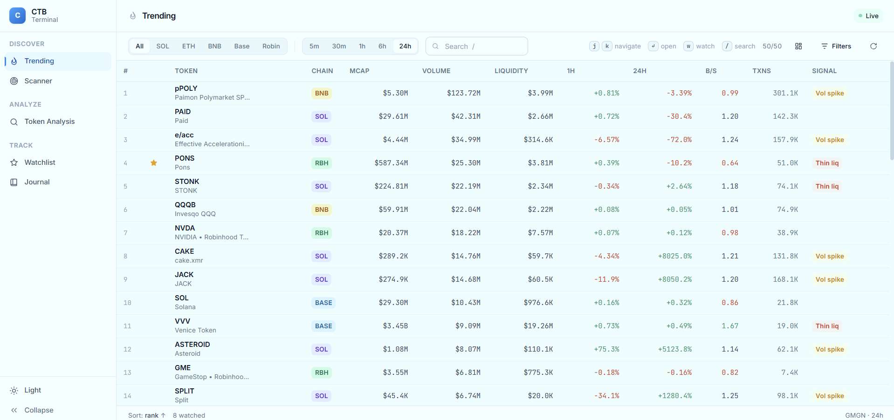

*The Trending page ranks the tokens getting the most attention right now. Use the tabs
at the top to filter by blockchain (All / SOL / ETH / BNB / Base / Robinhood) or by time
window (5m to 24h). Each row shows the token, its chain, market cap, volume, liquidity,
price change, and buy/sell ratio. The right-hand **Signal** column flags what stands out -
for example "Vol spike" (a sudden jump in trading) or "Thin liq" (dangerously low
liquidity).*

### Scanner - the ranked opportunity list

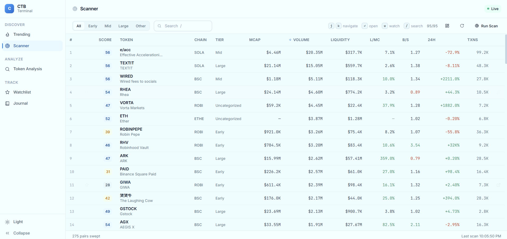

*The Scanner shows every token that survived the automated filters, each given a **score
from 0 to 100** (leftmost column) and sorted best-first. The tabs group tokens by
market-cap tier (Early / Mid / Large). The footer shows how many pairs were swept and
when the last scan ran. This is the core "which tokens are worth a look" view.*

### Token Analysis - deep dive on one token

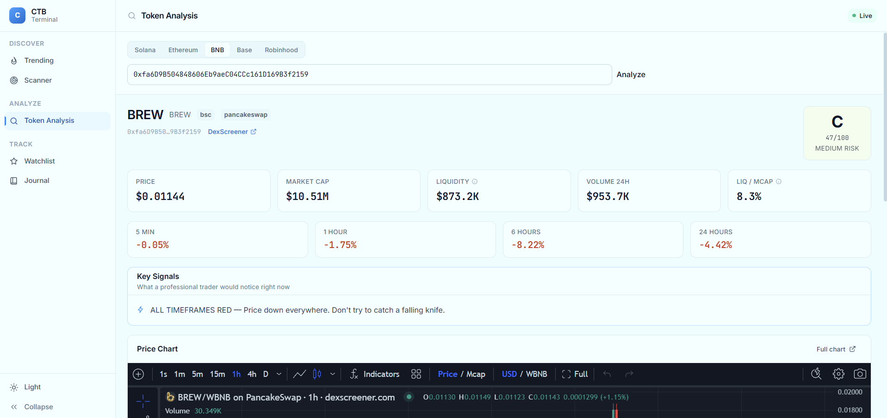

*Paste any token's contract address and pick its chain to get a full breakdown. The card
on the right gives an overall **letter grade, a 0-100 score, and a risk level**. Below
are the key metrics (price, market cap, liquidity, 24h volume) and short-term price
changes. The **Key Signals** panel summarizes, in plain English, what a trader would
notice - here, "all timeframes red" warning against buying a falling token. An
interactive price chart sits underneath.*

<details>
<summary><b>More Token Analysis views (the technical-analysis detail)</b></summary>

**Key signals + price chart**
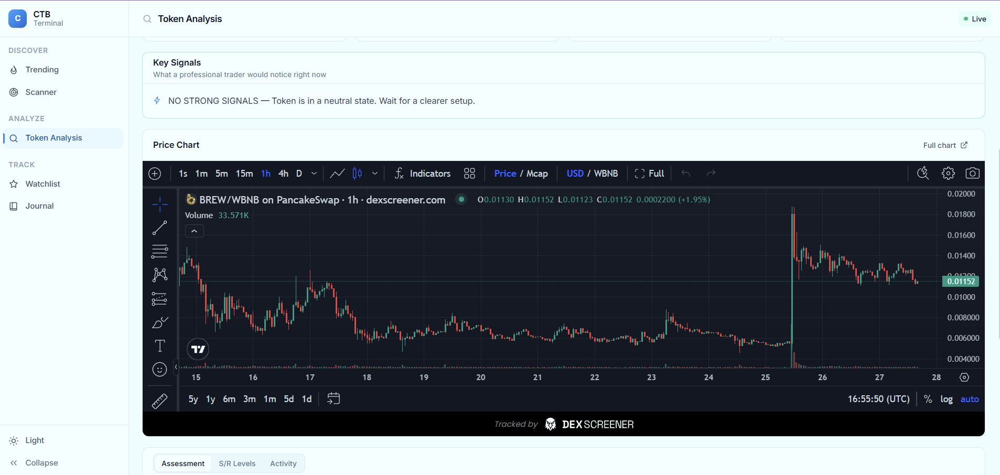
*The actionable signals shown first, followed by the live candlestick price chart.*

**Assessment - grade breakdown**
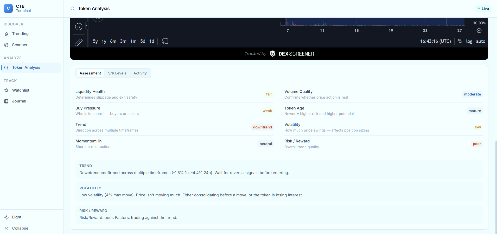
*Each factor behind the overall grade, scored individually: liquidity health, volume
quality, buy pressure, token age, trend, and volatility - with a one-line "why it
matters" next to each.*

**Support / resistance levels**
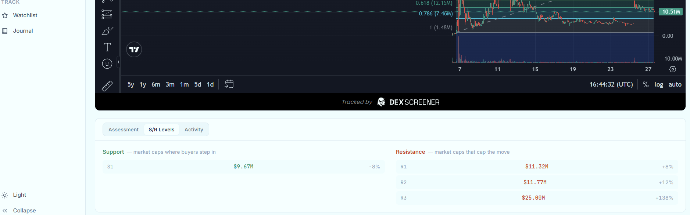
*Market-cap levels where buyers tend to step in (support) or where a rally tends to
stall (resistance), with the distance from the current price.*

**Activity - transactions, volume, metadata**
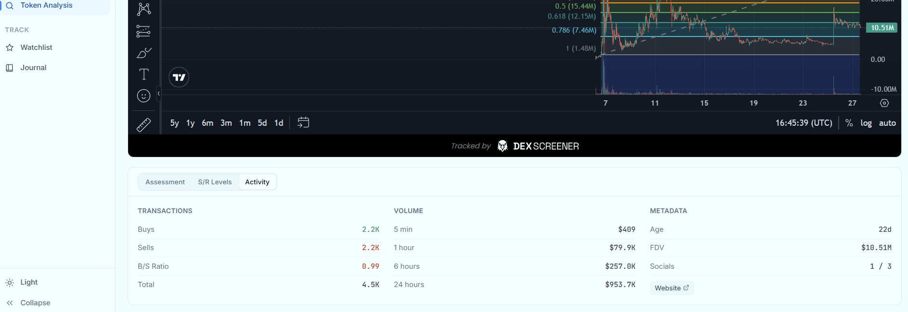
*Buy vs sell counts, volume across timeframes, and token metadata (age, socials, links).*

</details>

### Watchlist - track and get alerted

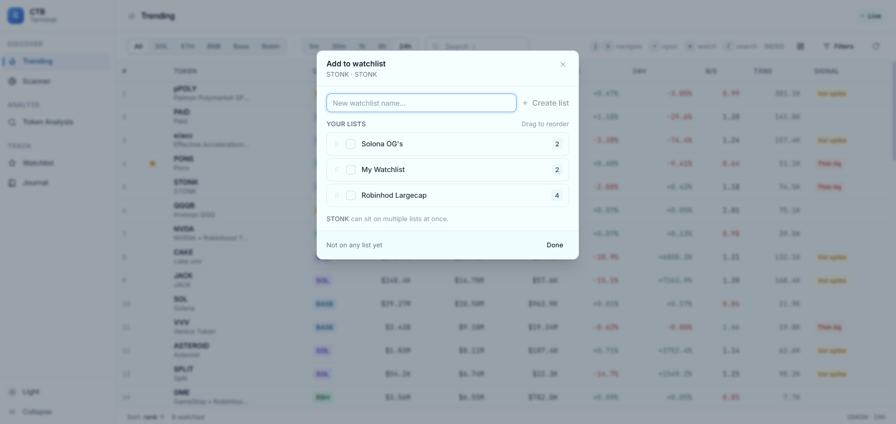

*Save interesting tokens to named lists and watch them update live. You can set alert
conditions (e.g. price or volume crossing a threshold) so the app flags a token the
moment your condition is met.*

<details>
<summary><b>Watchlist alerts</b></summary>

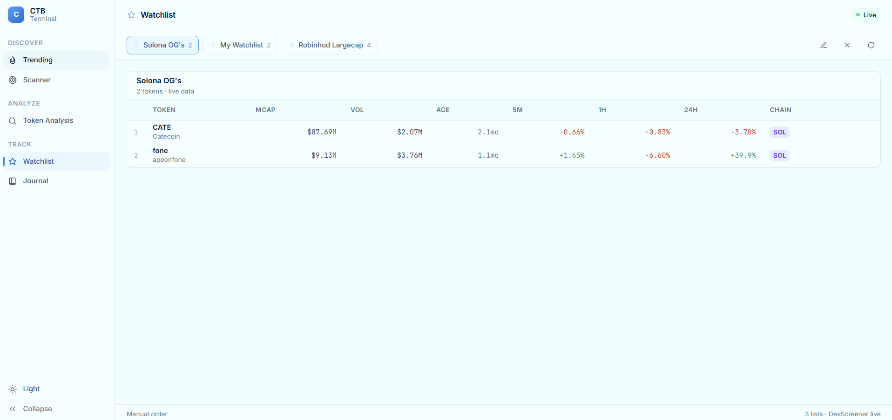
*The Triggered Alerts panel: conditions that have been met since you last checked.*

</details>

### Trade Journal - review and improve

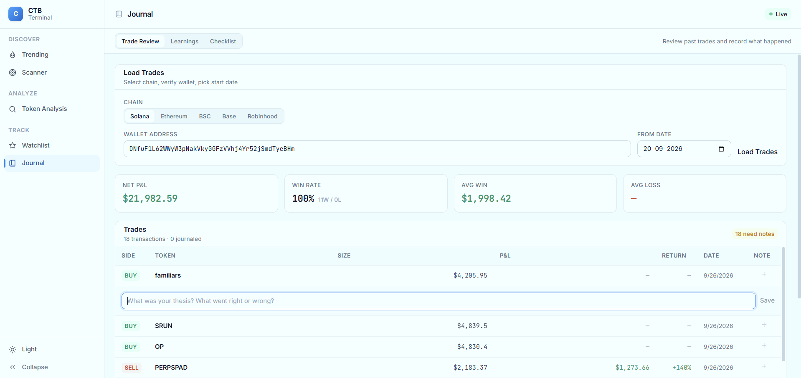

*A place to log trades and review them. The Trade Review tab lists your trades in a
compact table; the other tabs hold running "learnings" and a reusable pre-trade
checklist - the discipline layer that turns individual trades into a repeatable process.*

<details>
<summary><b>More Journal views</b></summary>

**Learnings**
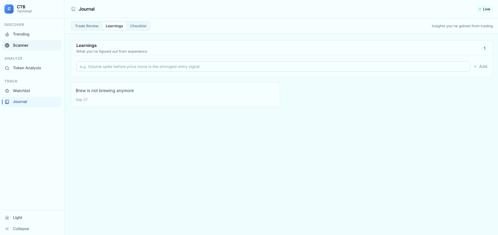
*A running list of lessons captured from past trades.*

**Pre-trade checklist**
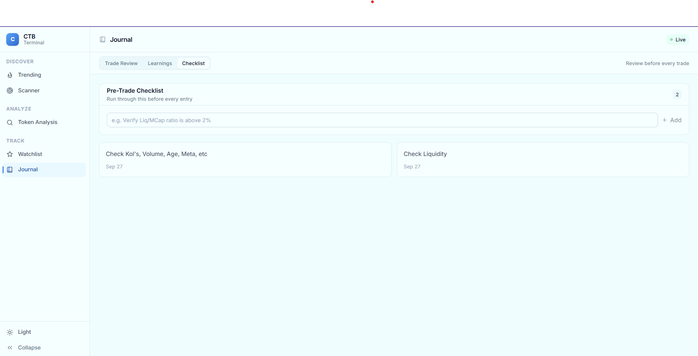
*A reusable checklist to run before entering a trade, so nothing gets skipped.*

</details>

---

## How it works

CTB has two halves that talk over a REST API. A scheduler inside the backend re-runs the
scan on a timer, so the dashboard always shows fresh data without anyone clicking a
button.

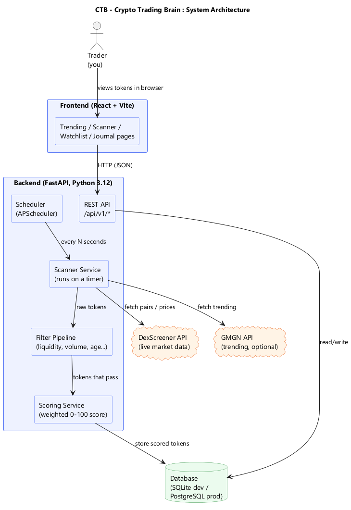

A single scan turns raw market data into a clean, ranked list:

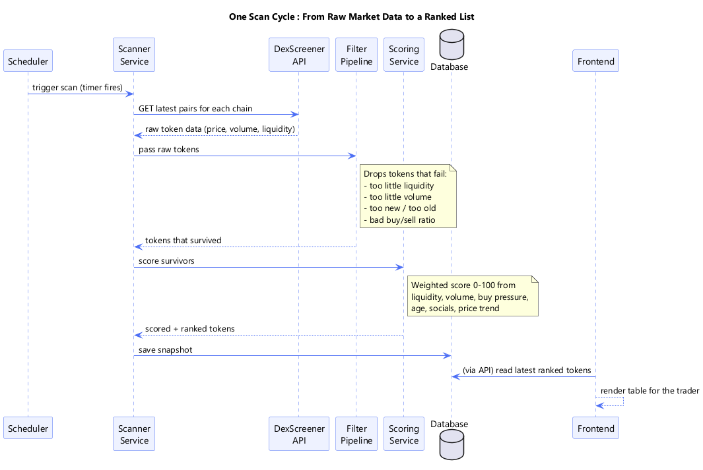

1. The **scheduler** fires on a timer.
2. The **scanner** pulls live token data from DexScreener (and trending data from GMGN, optional).
3. The **filter pipeline** drops tokens that are too illiquid, too quiet, too new/old, or show weak buying.
4. The **scoring service** gives each survivor a weighted 0-100 score.
5. Results are stored and served to the frontend.

The **score** is a weighted blend of six signals, all configurable in `.env` so you can
retune the strategy without touching code:

| Signal | Default weight | Why it matters |
|--------|---------------:|----------------|
| Volume | 0.25 | Real activity / interest |
| Liquidity | 0.20 | Can you actually get in and out? |
| Buy pressure | 0.20 | Momentum - buyers vs sellers |
| Price trend | 0.15 | Direction across timeframes |
| Token age | 0.10 | Not too new (risky), not too old (stale) |
| Social presence | 0.10 | Is anyone talking about it? |

The backend package layout:

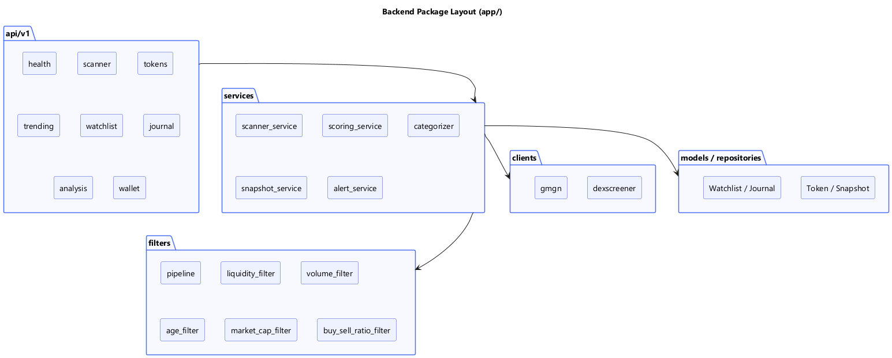

> Diagrams are generated from PlantUML sources in [`docs/diagrams/`](docs/diagrams/).
> See [rendering the diagrams](docs/ARCHITECTURE.md#rendering-the-diagrams).

---

## Features by section

| Section | What it does |
|---------|--------------|
| **Trending** | Live trending tokens across chains, filterable by network and time interval, with a signal tag (momentum, breakout, thin liquidity, dumping...). |
| **Scanner** | The full ranked list of tokens passing the filters, scored 0-100 and grouped by market-cap tier (Early / Mid / Large). Customizable, reorderable columns. |
| **Token Analysis** | Deep dive on any token by contract address: letter grade, liquidity/volume/momentum metrics, embedded price chart, support/resistance levels, and a plain-English risk assessment. |
| **Watchlist** | Save tokens to named lists, watch them update live, and set alert conditions that notify you when met. |
| **Journal** | Trade review log, a running "learnings" list, and a reusable pre-trade checklist. |

Cross-cutting: light/dark theme, collapsible sidebar, live status indicator, and
keyboard navigation.

---

## Tech stack

**Backend**
- Python 3.12, FastAPI, Uvicorn
- SQLAlchemy 2.0 + Alembic (migrations)
- APScheduler (periodic scanning)
- Pydantic v2 / pydantic-settings (typed, validated config)
- httpx (async HTTP), pandas
- SQLite for local dev, PostgreSQL for production

**Frontend**
- React 18 + TypeScript
- Vite (dev server + build)
- TailwindCSS
- TanStack Table

**Tooling**
- pytest, pytest-asyncio, pytest-cov
- ruff (lint + format)
- Docker Compose (Postgres for prod-like local runs)

---

## Getting started

### Prerequisites
- Python 3.12+
- Node.js 18+
- (Optional) PostgreSQL - not required; the app defaults to SQLite.

### 1. Backend

```bash
cd backend
python -m venv .venv

# Windows
.venv\Scripts\activate
# macOS / Linux
# source .venv/bin/activate

pip install -r requirements.txt

# Windows
copy .env.example .env
# macOS / Linux
# cp .env.example .env

uvicorn app.main:app --reload
```

API runs at `http://localhost:8000`. Interactive API docs at `http://localhost:8000/docs`.

### 2. Frontend

```bash
cd frontend
npm install
npm run dev
```

Vite prints a local URL (usually `http://localhost:5173`). Open it in your browser and
let a scan run so the tables fill with data.

---

## Configuration

All thresholds, scoring weights, supported chains, and the scan interval live in `.env`
(typed and validated via `app/config.py`), so you can retune the whole strategy without
editing code.

**Never commit your real `.env`** - it is git-ignored. Commit `.env.example` instead, and
keep secrets (API keys) and personal wallet addresses out of version control.

---

## Project structure

```
ctb/
├── backend/                 FastAPI app
│   └── app/
│       ├── api/v1/           REST endpoints (scanner, tokens, trending, watchlist, journal, analysis, wallet, health)
│       ├── services/         business logic (scanning, scoring, categorizing, snapshots, alerts)
│       ├── filters/          filter pipeline + individual filters
│       ├── clients/          external data clients (DexScreener, GMGN)
│       ├── models/           SQLAlchemy tables
│       ├── repositories/     data access layer
│       ├── scheduler/        periodic scan jobs
│       └── core/             database, logging, config, exceptions
├── frontend/                React + Vite + Tailwind UI
│   └── src/
│       ├── pages/            Trending, Scanner, Token Analysis, Watchlist, Journal
│       ├── components/       layout + shared UI
│       ├── hooks/            data-fetching + UI hooks
│       └── services/         API client
├── docs/
│   ├── ARCHITECTURE.md       deeper walkthrough + glossary
│   ├── diagrams/             PlantUML sources + rendered PNGs
│   └── screenshots/          UI screenshots for this README
└── docker-compose.yml
```

---

## Roadmap

- Scam / rug-pull detection heuristics
- Deeper technical-analysis indicators on price candles
- AI-assisted trade analysis
- Performance analytics over the trade journal
- Tracked-wallet and KOL activity signals

---

## Disclaimer

CTB is a personal engineering project built for learning and portfolio purposes. It is
**not financial advice** and makes no guarantee of accuracy. Trading crypto assets is
risky and you can lose money.
