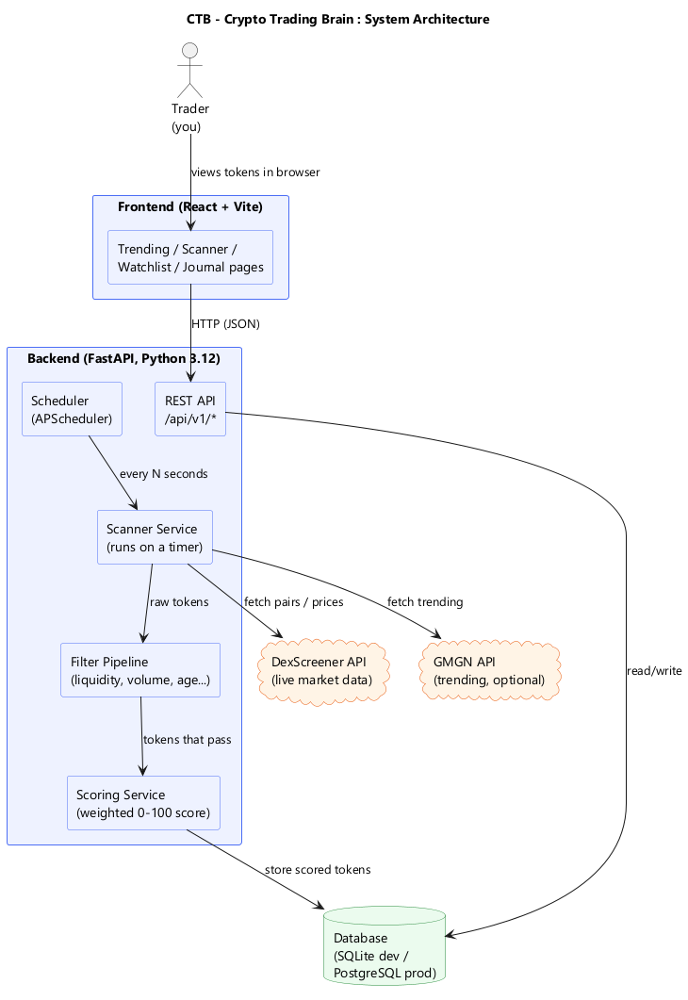
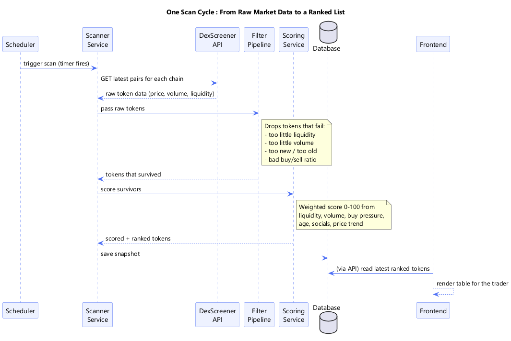
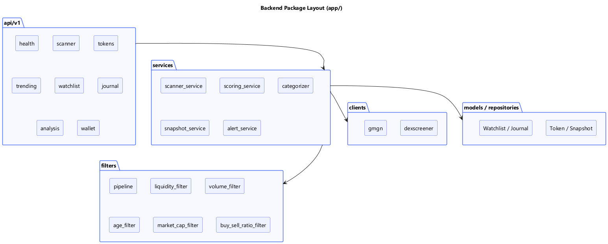

# CTB Architecture

This document explains how **CTB (Crypto Trading Brain)** is put together, written so
that someone new to crypto and blockchain can follow along.

## The 30-second version

CTB watches new and trending crypto tokens across several blockchains, filters out the
junk, gives each surviving token a health score from 0 to 100, and shows the best
candidates in a web dashboard. Think of it as a stock screener, but for fast-moving
"memecoins".

## A few crypto terms first

If you are new to this space, here is just enough to read the rest of the doc.

| Term | Plain-English meaning |
|------|-----------------------|
| **Blockchain** | A shared public ledger. Solana, Ethereum, and Base are different blockchains (different "networks"). |
| **Token / coin** | A tradable asset that lives on a blockchain. A "memecoin" is a small, often meme-themed token. |
| **Market cap** | Roughly, the total value of all coins in circulation (price x supply). Bigger = more established. |
| **Liquidity** | How much money is available to trade against. Low liquidity means you can't sell without crashing the price. |
| **Volume** | How much was traded in a period (e.g. last 24h). High volume = lots of activity. |
| **Buy/sell ratio** | Are more people buying or selling right now? A proxy for momentum. |
| **DEX** | Decentralized exchange (where these tokens trade). **DexScreener** is a public data source for DEX prices. |
| **Scalping** | A trading style: many small, fast trades to capture quick moves. |

## System architecture

The system has two halves: a **React frontend** (what you see in the browser) and a
**FastAPI backend** (the brain that fetches data, filters, and scores it). A scheduler
inside the backend re-runs the scan on a timer, so the data stays fresh without anyone
clicking a button.



> The image above is rendered from [`diagrams/system-architecture.puml`](diagrams/system-architecture.puml).
> See [Rendering the diagrams](#rendering-the-diagrams) for how to generate the PNG.

## How one scan works

Every scan cycle turns raw market data into a clean, ranked list:

1. The **scheduler** fires on a timer.
2. The **scanner service** pulls the latest token data from **DexScreener** (and,
   optionally, trending data from GMGN).
3. The **filter pipeline** throws away tokens that are too illiquid, too quiet, too
   new, too old, or showing weak buying.
4. The **scoring service** gives every survivor a weighted 0-100 score.
5. Results are saved to the **database** and served to the frontend.



> Rendered from [`diagrams/scan-pipeline-sequence.puml`](diagrams/scan-pipeline-sequence.puml).

## How the scoring works

Each token's score is a weighted blend of six signals. The weights live in configuration
(`.env`), so you can tune the strategy without touching code:

| Signal | Default weight | Why it matters |
|--------|---------------:|----------------|
| Volume | 0.25 | Activity / interest |
| Liquidity | 0.20 | Can you actually get in and out? |
| Buy pressure | 0.20 | Momentum |
| Price trend | 0.15 | Direction |
| Token age | 0.10 | Not too new (risky), not too old (stale) |
| Social presence | 0.10 | Is anyone talking about it? |

The weights sum to 1.0. Market-cap "categories" (Early / Mid / Large) each have their
own minimum volume and liquidity thresholds, also configurable.

## Backend package layout



> Rendered from [`diagrams/component-structure.puml`](diagrams/component-structure.puml).

- `api/v1/` - REST endpoints (health, scanner, tokens, trending, watchlist, journal, analysis, wallet)
- `services/` - business logic (scanning, scoring, categorizing, snapshots, alerts)
- `filters/` - the filter pipeline and each individual filter
- `clients/` - HTTP clients for external data sources (DexScreener, GMGN)
- `models/` + `repositories/` - database tables and data access
- `scheduler/` - the timer that re-runs scans
- `core/` - database, logging, config, exceptions

## Rendering the diagrams

The `.puml` files are the source of truth. To turn them into the PNG images the README
references:

**Option A - VS Code extension (easiest)**
1. Install the "PlantUML" extension.
2. Open a `.puml` file, press `Alt+D` to preview, then export as PNG into the same
   `docs/diagrams/` folder with the matching name (e.g. `system-architecture.png`).

**Option B - Online**
1. Go to the PlantUML web server (`https://www.plantuml.com/plantuml`).
2. Paste the contents of a `.puml` file, download the PNG, and save it next to the
   `.puml` with the same base name.

**Option C - Command line** (requires Java + `plantuml.jar`)
```bash
java -jar plantuml.jar docs/diagrams/*.puml
```

Once the PNGs exist in `docs/diagrams/`, the README and this doc display them
automatically.
